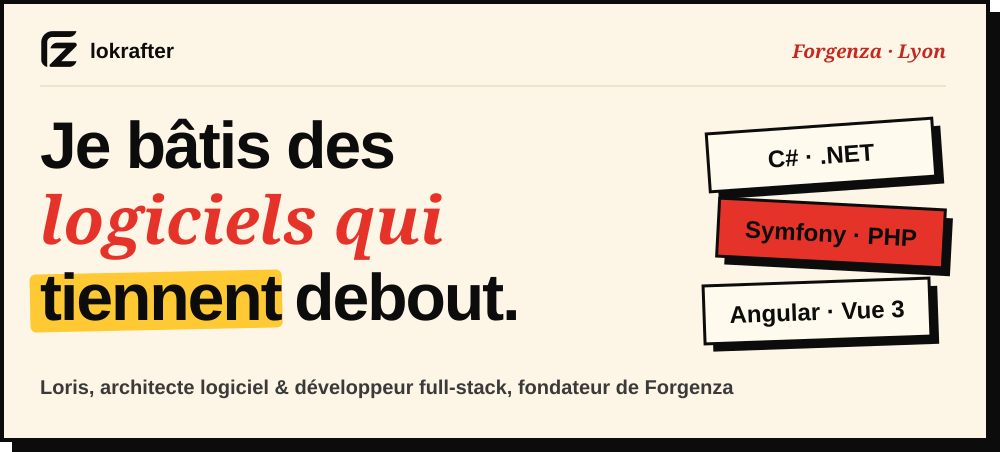
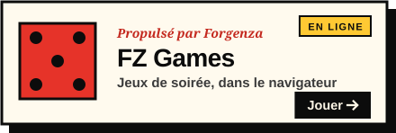
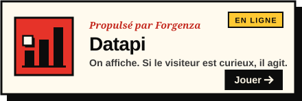
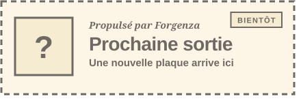
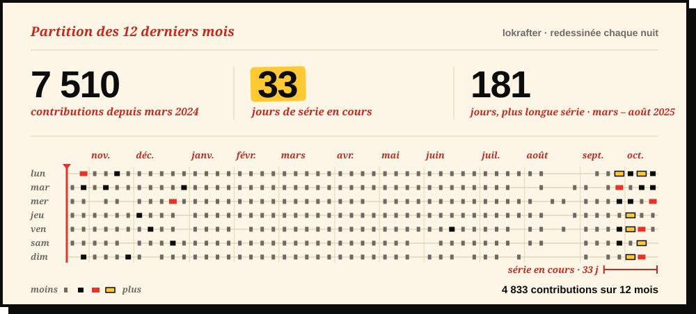
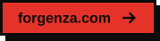
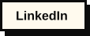
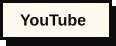

<!-- README de lokrafter · DA Forgenza « L'Affiche »
     Les blocs PLAQUES et PARTITION sont réécrits par scripts/readme.mjs :
     modifie plaques.yml plutôt que ces blocs. -->

<a href="https://forgenza.com">
  <picture>
    <source media="(prefers-color-scheme: dark)" srcset="assets/affiche-sombre.svg">
    
  </picture>
</a>

 

<!-- PLAQUES:DEBUT · généré depuis plaques.yml, ne pas éditer à la main -->

  <a href="https://games.forgenza.com"><picture><source media="(prefers-color-scheme: dark)" srcset="assets/plaques/fz-games-sombre.svg"></picture></a>
  <a href="https://datapi.fr"><picture><source media="(prefers-color-scheme: dark)" srcset="assets/plaques/datapi-sombre.svg"></picture></a>

  <picture><source media="(prefers-color-scheme: dark)" srcset="assets/plaques/bientot-sombre.svg"></picture>

<!-- PLAQUES:FIN -->

 

<!-- PARTITION:DEBUT · redessinée chaque nuit par .github/workflows/readme.yml -->
<picture><source media="(prefers-color-scheme: dark)" srcset="assets/partition-sombre.svg"></picture>
<!-- PARTITION:FIN -->

 

  <a href="https://forgenza.com"><picture><source media="(prefers-color-scheme: dark)" srcset="assets/boutons/forgenza-sombre.svg"></picture></a>
  <a href="https://fr.linkedin.com/in/loris-c-b70255b5"><picture><source media="(prefers-color-scheme: dark)" srcset="assets/boutons/linkedin-sombre.svg"></picture></a>
  <a href="https://www.youtube.com/@aquariophilelyonnais794"><picture><source media="(prefers-color-scheme: dark)" srcset="assets/boutons/youtube-sombre.svg"></picture></a>

